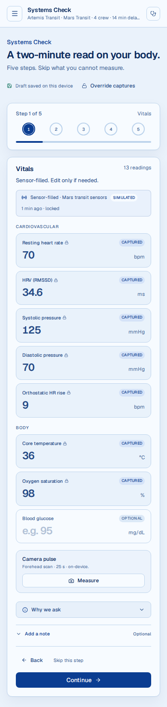
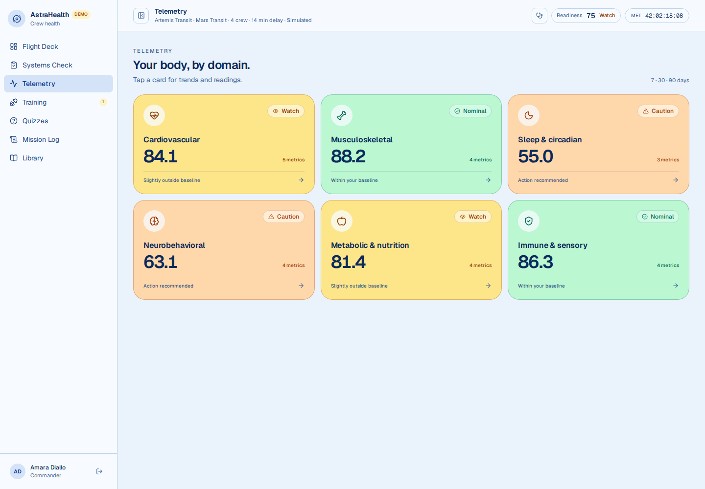
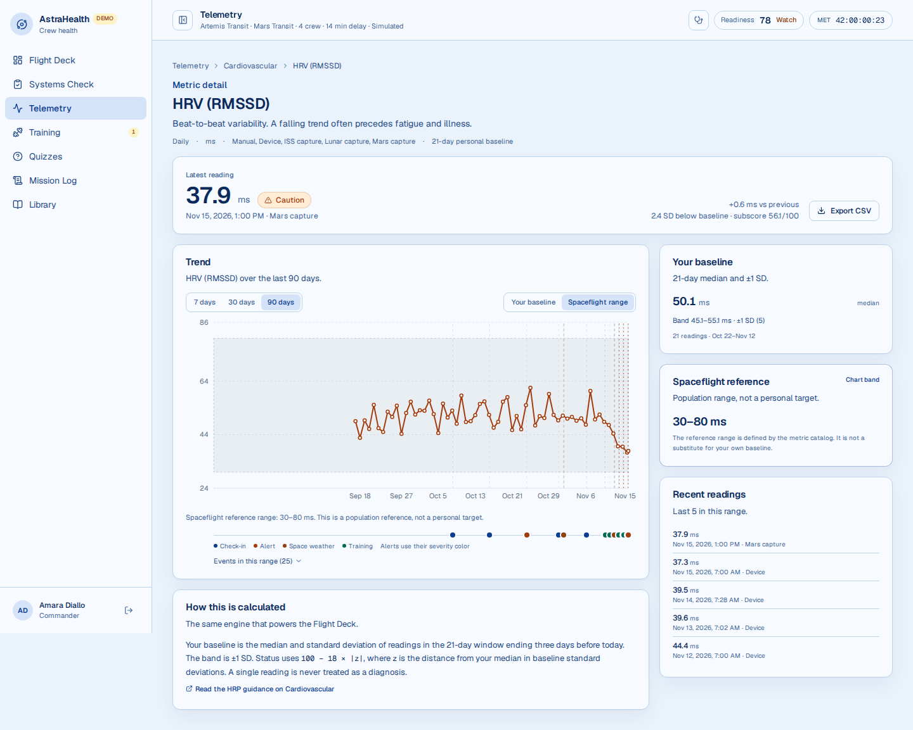
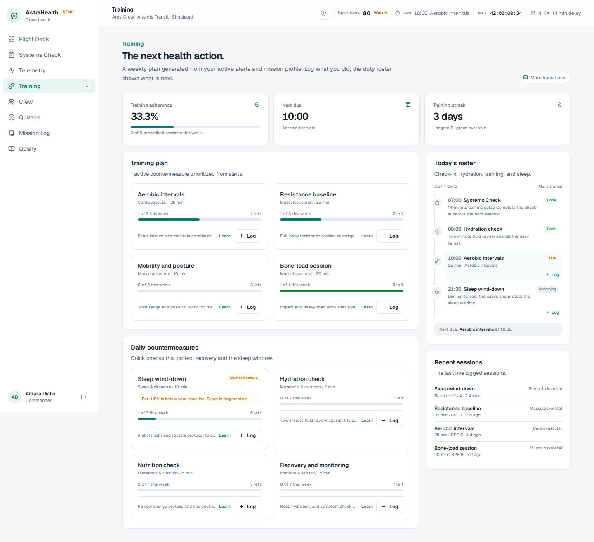
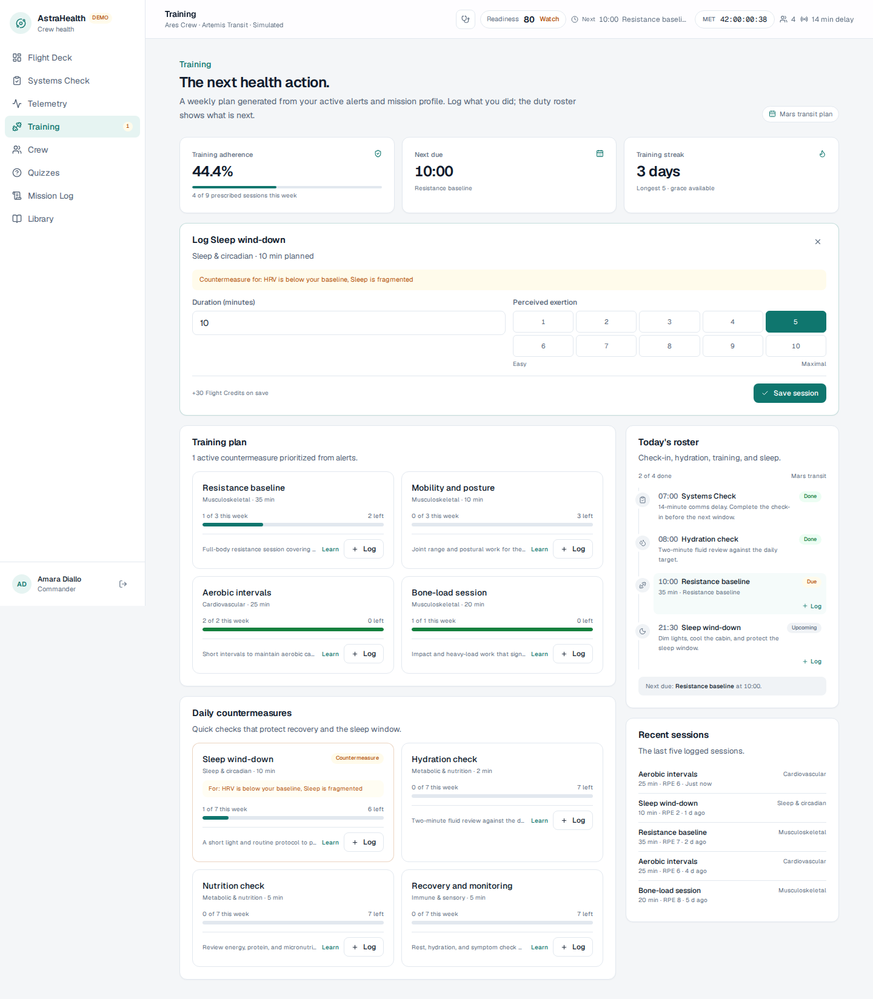
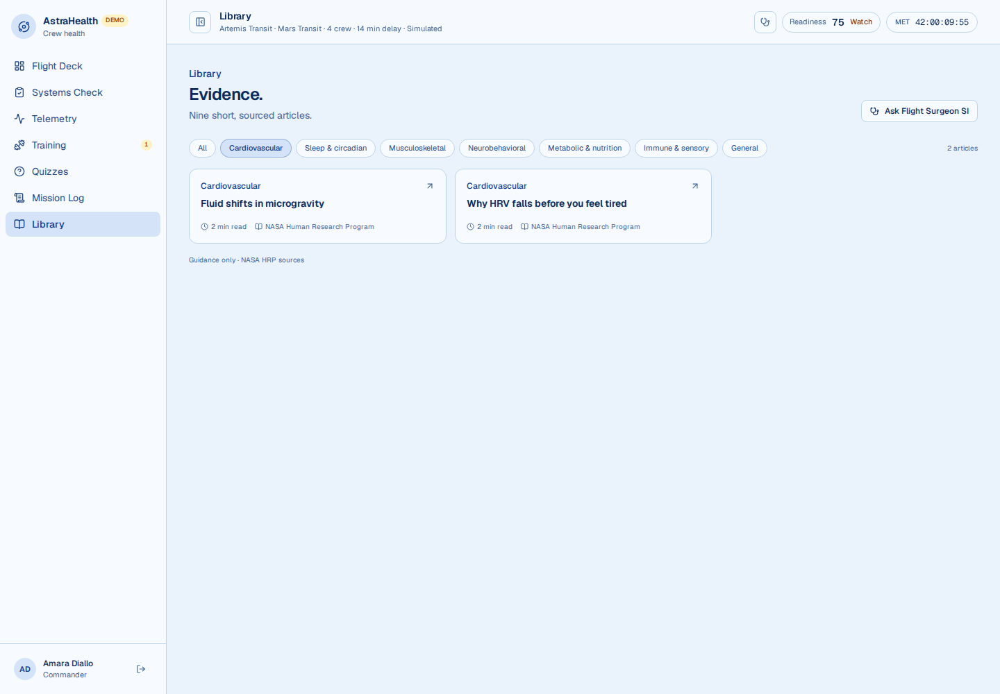
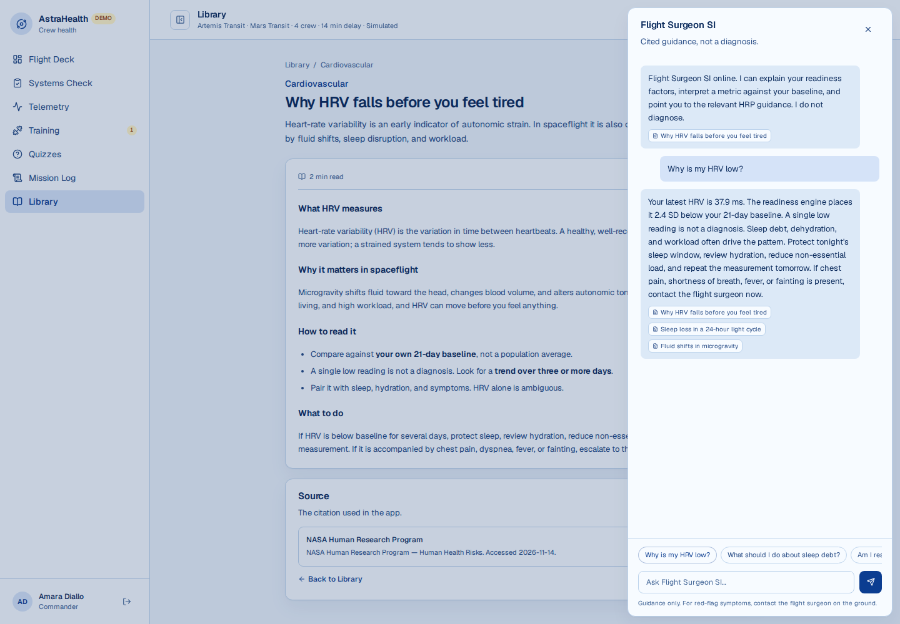

# AstraHealth

**A calm flight deck for the human body.** A light, low-density health monitor for astronauts on long-duration missions: collect health indicators, explain what they mean in spaceflight, score crew readiness, and recommend the next action.

> Status: **Phase 11 complete — demo ready.** The app builds from a clean database, `make demo-verify` checks the scripted state, and the three-minute script runs end to end. See [`docs/PLAN.md`](docs/PLAN.md) for the full build plan.

> **Windows and never used a terminal?** Start with [`START_HERE_WINDOWS.md`](START_HERE_WINDOWS.md). It walks you through installing Docker Desktop, Node.js, and uv, then launches everything with a double-click.


| Systems Check | Systems Report |
|---|---|
|  |  |

| Telemetry | Metric detail |
|---|---|
|  |  |

| Domain summary | Reference range |
|---|---|
|  |  |

| Crew | Mission Log |
|---|---|
|  |  |

| Quizzes | Quiz result |
|---|---|
|  |  |

| Training plan | Countermeasure link |
|---|---|
|  |  |

| Library | Flight Surgeon |
|---|---|
|  |  |

| Offline queue | Offline shell |
|---|---|
|  |  |

---

## What it does

- **Flight Deck** — a 70+ region anatomical body map with front/back views, readiness ring, six domain rows, an exception list, and a mission tape.
- **Automatic captures** — simulated ISS habitat, lunar surface, and Mars transit sensors stream heart rate, HRV, blood pressure, temperature, SpO₂, body mass, and exercise/bone load into Telemetry, and pre-fill the Systems Check. Sleep, mood, stress, symptoms, strength, hydration, and nutrition stay astronaut-entered.
- **Systems Check** — a five-step wizard whose vitals and load arrive locked from the capture feed; a single **Override captures** toggle unlocks them if a sensor is unavailable. The astronaut adds sleep, mood, symptoms, strength, hydration, and nutrition. Drafts survive a reload, skipped steps are explicit, and every submission ends in an instant Systems Report.
- **Telemetry** — 7, 30, or 90-day trends for every metric, with a personal baseline band, a spaceflight reference range, event overlays, domain summaries, and CSV export.
- **Explainable readiness** — deterministic z-score engine plus seven hard rules. Every score shows its contributing factors.
- **Emergency triage** — a one-tap protocol with ordered immediate actions, active alerts, the next comms window, and a copyable flight-surgeon handoff.
- **Mission environments** — switch between Mars transit, lunar surface, and space station; profile weights, comms delay, and the training plan update immediately.
- **Handoff and routine exports** — print or save the Systems Report as PDF, export it as JSON, and add today’s Duty Roster to a calendar as `.ics`.
- **Training and Duty Roster** — a weekly plan generated from active alerts and the mission profile, countermeasure links from every alert, session logging with RPE, adherence and streaks, a daily roster, and a next-due indicator in the nav and top bar.
- **Motivation** — a credit ledger, Mission Rank, commendations, a one-time allowance catalog, streaks with a single grace day, and a Mission Log that records the whole loop. Never tied to health values.
- **Crew** — consent-based status sharing, a privacy-filtered readiness roster, and a consistency board with no health values. Direct crew communication stays outside the health tool.
- **Flight Surgeon console** — a separate Earth-side dashboard for the medical officer: all crew readiness and alerts, the full capture and manual record, metric trends, clinical assessments/diagnoses, alert acknowledgement, and instructions or check-in requests sent back to the crew. Shared assessments and requests appear on the astronaut’s Flight Deck.
- **Early warning and Clinical Copilot** — a transparent 48–72-hour risk view per crew member (HRV, sleep, temperature, oxygen, hydration, mood, and more) with evidence and monitoring suggestions, plus a decision-support copilot that summarizes the record, explains the risk, and suggests questions. When a signal crosses a threshold, the system also creates one deduplicated **focused follow-up request** for the astronaut (urgent recheck, cardiovascular, respiratory, recovery, mood, hydration, or training), with target readings and a due time. The copilot refuses diagnosis, prescriptions, and doses; the flight surgeon makes the clinical decision.
- **Quizzes** — Know Yourself and the consent-gated Know Your Crew, with scoring, source explanations, and a first-completion credit award.
- **Knowledge and AI** — nine HRP-sourced articles with domain filters, inline guidance from metrics, alerts, check-in steps, and training items, and a Flight Surgeon drawer that cites its sources, refuses diagnosis, and escalates red flags. Works without an LLM.
- **Camera pulse** — optional 25-second rPPG measurement with MediaPipe FaceLandmarker, signal-quality gating, and a manual heart-rate field that is always available.
- **Offline-first PWA** — a Workbox service worker precaches the shell and route chunks, and the last readiness/alerts/mission snapshot is cached per user for offline viewing with a “last synced” label. Check-ins submitted without a link are written to IndexedDB, shown in an explicit offline banner with the next comms window, and synced exactly once on reconnect using the check-in idempotency key. Failed items can be reviewed and discarded.
- **Hardened delivery** — route-level code splitting, cached auth profile for offline reloads, retryable error panels on every data view, and auth rate limits. Lighthouse on the Flight Deck: 100 performance / 100 accessibility on desktop and 99–100 performance / 100 accessibility on the mobile preset across verification runs.

---

## Stack

| Layer | Choice |
|---|---|
| Frontend | React 19, TypeScript, Vite 8, Tailwind CSS v4 |
| Animation | motion |
| Data | TanStack Query, typed client generated from OpenAPI |
| Backend | FastAPI, Pydantic v2, SQLAlchemy 2, Alembic |
| Database | PostgreSQL 16 (Docker or Podman) |
| Auth | JWT access + refresh, Argon2 |
| Client | `openapi-typescript` types + `openapi-fetch` |
| Camera | MediaPipe Tasks Vision |
| PWA | `vite-plugin-pwa` (Workbox), IndexedDB via `idb` |
| Tests | Pytest, Playwright, Lighthouse |

---

## Quick start

Requirements: Docker (or Podman with the Compose plugin), [`uv`](https://docs.astral.sh/uv/), Node 22+.

```bash
cp .env.example .env
make install
make start
```

`make start` starts PostgreSQL if needed, applies migrations, seeds the demo state, and runs both servers. Press **Ctrl+C** to stop the API and web app; PostgreSQL stays running.

`make start-demo` resets the scripted mission to day 42 first. Use it (or run `make reset-demo`) when the database was seeded on an earlier day.

Prefer separate terminals? Use `make db`, then `make api` and `make web` in two shells.

Open **http://localhost:5173** — sign in with a demo account. The shell shows a **Demo** badge for the seeded mission. Signing in as `surgeon@astra.space` opens the Earth-side clinical console at `/surgeon`; the crew accounts open the Flight Deck. The styleguide is hidden in demo mode; set `VITE_DEMO_MODE=false` and restart Vite to expose `/styleguide`.

### Demo mode

`VITE_DEMO_MODE` defaults to on. It shows the **Demo** badge, labels the mission as simulated, hides the design-system link, and redirects `/styleguide` to the Flight Deck. Set `VITE_DEMO_MODE=false` while working on the design system.

After seeding, verify the scripted state:

```bash
make reset-demo
make demo-verify
```

`make demo-verify` checks the four crew accounts, privacy settings, commander readiness around 80 / Watch, the two expected alerts, mission day 42, space-weather context, and the content catalog (9 articles, 8 training items, 5 achievements, 4 rewards, 2 quizzes).

### Optional integrations

Everything works with safe local defaults:

- **NASA space weather** — set `NASA_API_KEY` (or `DEMO_KEY`) for live DONKI context. The endpoint is cached for 30 minutes, falls back to the seeded event on any failure, and the UI labels the source as live or fixture.
- **AI Flight Surgeon** — defaults to `LLM_PROVIDER=none`, which uses the deterministic cited answer engine. Set `LLM_PROVIDER=openai`, `LLM_API_KEY`, and `LLM_MODEL` to use an OpenAI-compatible chat endpoint; `LLM_BASE_URL` defaults to `https://api.openai.com/v1`. Refusal and red-flag answers always stay rule-based.
- **Camera pulse** — MediaPipe WASM and the face model load from CDN at runtime; no camera assets are committed. Override `VITE_MEDIAPIPE_WASM_URL` and `VITE_MEDIAPIPE_MODEL_URL` to self-host them. Camera permission is optional and the manual heart-rate field remains the fallback.

### View on a phone / install as a PWA

Browsers only allow service-worker installation over **HTTPS** (or `localhost`). A plain `http://192.168.x.x` address will display the app but will not be installable. For a temporary phone demo, use a same-origin HTTPS tunnel:

```bash
# 1. Keep the API running (make start, or make api + make db)
# 2. Build a same-origin frontend where /api is proxied to FastAPI
cd frontend
npm run build:phone

# 3. Serve the production build on 4173
npm run preview:phone

# 4. In another terminal, expose 4173 with a temporary HTTPS URL
cloudflared tunnel --url http://127.0.0.1:4173 --protocol http2
```

Open the printed `https://...trycloudflare.com` address on the phone, sign in with `commander@astra.space` / `astra-demo`, then use **Install app** (Android Chrome) or **Share -> Add to Home Screen** (iOS Safari). The tunnel is public while it runs, so stop it with Ctrl+C when finished. `cloudflared` is a separate free tool from Cloudflare; the app itself does not need it.

### Demo accounts

After `make seed` (or `make reset-demo`), use any of these at `POST /auth/login`:

| Account | Role | Use |
|---|---|---|
| `commander@astra.space` | Commander | Primary demo; HRV and sleep anomaly |
| `pilot@astra.space` | Pilot | Febrile episode; critical alert |
| `specialist@astra.space` | Specialist | Mood and social withdrawal |
| `engineer@astra.space` | Engineer | Stable control |
| `surgeon@astra.space` | Flight Surgeon | Earth-side console; opens at `/surgeon` |

Password for all demo accounts: `astra-demo`. The surgeon is not a crew member and does not consume a seat in the roster.

### Ports

| Service | Port |
|---|---|
| Web | 5173 |
| API | 8000 |
| PostgreSQL | 5432 |

---

## Commands

| Command | Purpose |
|---|---|
| `make install` | Install backend (`uv sync`) and frontend (`npm install`) dependencies |
| `make db` | Start PostgreSQL |
| `make start` | Start PostgreSQL, API, and web app together |
| `make start-demo` | Rebuild the demo state, then start everything |
| `make api` | Run FastAPI with reload |
| `make web` | Run Vite |
| `make migrate` | Apply Alembic migrations |
| `make seed` | Seed the demo crew (idempotent) |
| `make reset-demo` | Rebuild the scripted demo state |
| `make demo-verify` | Check the scripted crew, readiness, alerts, and content |
| `make client` | Regenerate the typed API client from OpenAPI |
| `make test` | Backend tests |
| `cd frontend && npm run smoke` | Playwright smoke: the full shell, Library, assistant, camera fallback, offline queue, training, and session recovery |
| `npm run build && npx vite preview --port 4173` | Serve the production PWA build locally |
| `ASTRA_WEB_URL=http://localhost:4173 ASTRA_TEST_PWA=1 npm run smoke` | Run the same smoke suite against the PWA, including an offline shell reload |
| `make lint` | Ruff + oxlint |
| `make check` | Lint, test, typecheck, and build |

---

## Architecture

```
React 19 PWA (browser)
  ├─ TanStack Query ── typed openapi-fetch ──► FastAPI
  ├─ IndexedDB ── check-in drafts + per-user offline queue
  ├─ localStorage ── last synced readiness/alerts/mission snapshot (per user)
  ├─ Workbox service worker ── app shell and static assets only
  └─ MediaPipe FaceLandmarker ── on-device pulse estimate

FastAPI
  ├─ JWT auth, privacy, rate limits, flight-surgeon role
  ├─ simulated habitat/suit captures → measurements + provenance
  ├─ Earth-side console → crew record, assessments, instructions
  ├─ readiness engine + hard rules + alert lifecycle
  ├─ atomic check-in transaction
  └─ 9 HRP articles, quizzes, training, rewards

PostgreSQL 16
  └─ 25 tables, seeded mission, crew, telemetry, content, surgeon records

Optional: NASA DONKI (space weather) and an OpenAI-compatible LLM.
```

The check-in, measurements, symptoms, credits, streak, and achievements commit atomically. Readiness and alerts are computed immediately after and are best-effort: an engine failure never discards a health submission. Hard rules are evaluated even before a personal baseline exists, so a first check-in can still raise a red-flag alert. The offline queue keeps the same idempotency key across retries, so reconnect cannot create a duplicate.

---

## Structure

```
backend/      FastAPI service, models, rules, seed data, tests
frontend/     Vite app, design system, feature modules
scripts/      One-command local start script
docs/         Plan, API, design, sources, demo script
```

---

## Data honesty

AstraHealth does **not** access live astronaut health data. NASA does not publish a real-time per-astronaut health API. The product uses user-entered measurements, camera-derived heart rate, and clearly labeled simulated habitat/suit sensor captures, alongside simulated crew telemetry and public NASA HRP/OSDR material for reference ranges, countermeasures, and citations. The early-warning scores and clinical copilot are transparent heuristics and decision support, not validated medical devices or diagnostic systems. Space-weather context comes from NASA DONKI when a key is configured, with a labeled seeded fixture as the fallback.

AstraHealth provides guidance, not diagnosis. Red-flag findings always route to a flight surgeon.

### Local security model

The runtime is a single-user local deployment. JWTs are stored in `localStorage`, and the cached profile is used only to render the shell when the API is unreachable. The flight-surgeon role is separate and role-guarded; it intentionally sees all crew clinical data, while `share_status` only controls what crewmates can see in the peer roster. For offline viewing, the last readiness/alerts/mission snapshot is cached per user in `localStorage` and cleared on logout; it is never shared between accounts, and the service worker still does not cache API responses. Auth endpoints are rate-limited per client and email; CORS allows only the documented local origins. A public deployment should move tokens and clinical cache to secure, encrypted storage, terminate TLS, and put the API behind a real rate limiter.

---

## Documentation

- [`START_HERE_WINDOWS.md`](START_HERE_WINDOWS.md) — complete Windows beginner guide
- [`docs/PLAN.md`](docs/PLAN.md) — product, architecture, data model, phases, verification
- [`docs/DESIGN.md`](docs/DESIGN.md) — tokens, components, motion, accessibility
- [`docs/API.md`](docs/API.md) — endpoint contract
- [`docs/SOURCES.md`](docs/SOURCES.md) — scientific sources and data honesty
- [`docs/DEMO.md`](docs/DEMO.md) — three-minute demo script
